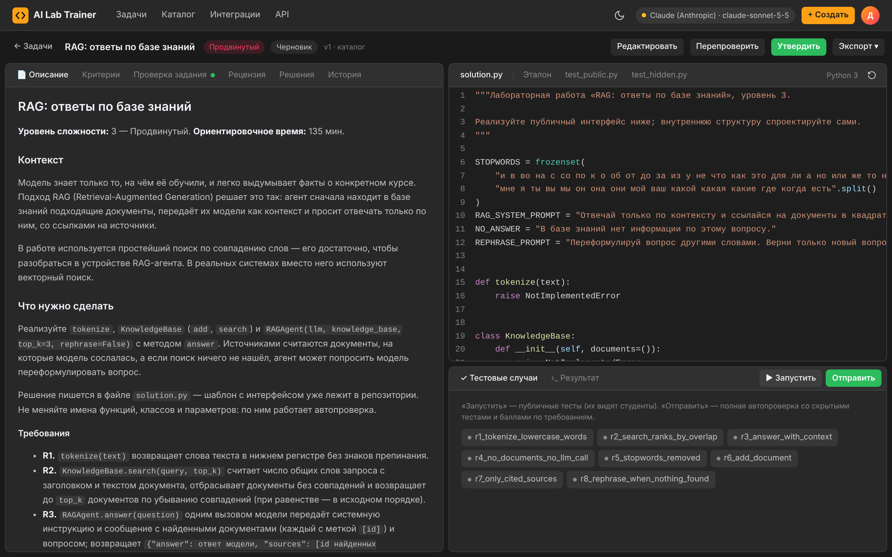
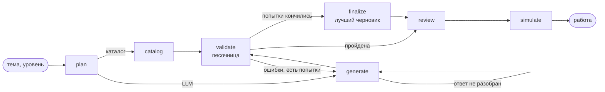

# AI Lab Trainer — ИИ-агент для создания лабораторных работ по агентной разработке

Преподаватель пишет тему занятия («Создание агента с инструментами») и выбирает уровень сложности.
ИИ-агент на **LangGraph** готовит лабораторную работу: условие, шаблон решения, эталон, автотесты и
критерии оценивания. Затем он сам проверяет её в песочнице, исправляет ошибки и даёт преподавателю
отредактировать и утвердить работу. Готовую работу можно экспортировать в Moodle и Gitverse, а
решения студентов — проверять автоматически.

Каждый пользователь подключает свою модель в аккаунте: Claude, OpenAI или локальную LLM.
Интерфейс сделан в стиле LeetCode: список задач с цветной сложностью, редактор кода, кнопки
«Запустить» и «Отправить».



## Соответствие критериям проекта

| Критерий | Как выполнен |
| --- | --- |
| Не менее 5 лабораторных работ | Каталог: 5 тем × 3 уровня = 15 проверенных работ. С подключённой LLM — генерация по любой теме |
| Минимум 3 уровня сложности | Базовый, средний, продвинутый. Уровень задаётся проверяемыми признаками (`labgen/levels.py`) |
| Задания создаются автоматически из темы | Граф LangGraph: тема → генерация → проверка → исправление → рецензия |
| Автопроверка ≥ 80% проверяемых требований | Во всех работах каталога автотесты проверяют 90% баллов; работу с покрытием ниже 80% утвердить нельзя |
| Интеграция или импорт в Moodle или Gitverse | Moodle — вопрос CodeRunner (Moodle XML); Gitverse — репозиторий студента с CI; плюс JSON API |
| Преподаватель редактирует задание перед публикацией | Редактор с подсветкой кода, версии с откатом, утверждение только после успешной проверки |

## Быстрый старт

```bash
python -m venv .venv && source .venv/bin/activate   # Windows: .venv\Scripts\activate
pip install -e .

labgen build-catalog --approve      # 15 работ каталога: создать, проверить, экспортировать (~30 с)
labgen serve                        # http://127.0.0.1:8000
```

Откройте http://127.0.0.1:8000, зарегистрируйтесь и в разделе **Интеграции** подключите модель.
Без модели доступен каталог: работы, созданные командой `build-catalog`, видны всем пользователям.

## ИИ-агент на LangGraph



Граф описан в `labgen/agent/graph.py`, схему выводит команда `labgen graph`.

| Узел | Что делает |
| --- | --- |
| `plan` | выбирает режим (каталог или LLM) и образец из каталога того же уровня для few-shot |
| `catalog` | берёт проверенную работу по теме |
| `generate` | LLM создаёт работу или исправляет её по замечаниям валидатора |
| `validate` | песочница: эталон проходит тесты, шаблон — нет, тесты ловят мутантов, покрытие ≥ 80% |
| `finalize` | если попытки исчерпаны, сохраняет лучшую версию как черновик |
| `review` | рецензия для преподавателя: правила плюс LLM, без баллов |
| `simulate` | LLM-«студенты» решают задание и оценивают понятность условия (по желанию) |

**Модели через LangChain.** `ChatAnthropic` для Claude, `ChatOpenAI` для OpenAI, а для локальных
моделей — `ChatOpenAI` со своим `base_url` (Ollama, LM Studio, vLLM). Модель пользователя передаётся
в граф через `config["configurable"]["llm"]`, поэтому один скомпилированный граф обслуживает всех
пользователей с их ключами. Шаги графа транслируются через `graph.stream(...)`, и страница генерации
показывает прогресс в реальном времени.

## Аккаунты и интеграции LLM

- Регистрация и вход по почте и паролю. Пароли хранятся как хеш scrypt, сессии — в подписанных cookie.
  Все формы и запросы API защищены CSRF-токеном.
- В разделе **Интеграции** настраиваются три вида моделей:
  - **Claude (Anthropic)** — API-ключ и модель;
  - **OpenAI** — API-ключ и модель;
  - **Локальная LLM** — адрес сервера (например, `http://localhost:11434/v1` для Ollama), модель и
    необязательный токен.

  Для каждой модели есть кнопка «Проверить подключение», и одну из них можно назначить моделью по умолчанию.
- API-ключи шифруются (Fernet) секретом приложения (`LABGEN_SECRET_KEY` или `data/secret.key`).
  В интерфейс ключ возвращается только маской `sk-…abcd`.
- Лабораторные привязаны к пользователю. Работы без владельца (каталог, созданный через CLI) общие.

## Интерфейс

| Страница | Что на ней |
| --- | --- |
| Задачи | список работ: статус, сложность (зелёный, жёлтый, красный), покрытие автопроверкой, мутанты; фильтры по теме, сложности и статусу; кольцо готовности к публикации |
| Работа | слева — условие, критерии, отчёт проверки, рецензия, решения, история версий; справа — редактор (`solution.py`, эталон, тесты) и консоль. «Запустить» прогоняет публичные тесты, «Отправить» — полную автопроверку с баллами по требованиям |
| Новая работа | тема, сложность, источник (каталог, Claude, OpenAI, локальная модель), материалы преподавателя |
| Генерация | шаги графа LangGraph в реальном времени |
| Аккаунт | профиль, интеграции LLM, смена пароля |

Тёмная тема по умолчанию, светлая включается переключателем. Редактор работает на CodeMirror 5
из локальных файлов, без CDN. Скриншоты лежат в `docs/screenshots/`.

## Автопроверка агентного кода

Студенты пишут агентов, которые обращаются к LLM. Поэтому их поведение каждый раз разное, и обычными
тестами «вход → выход» его не проверить. В тестах модель заменена на `ScriptedLLM` из `agentkit.py`.
Это «LLM по сценарию»: она отдаёт заранее заданные ответы, включая вызовы инструментов и сбои API,
и записывает все запросы агента. Тесты проверяют поведение:
- какие сообщения агент отправил модели;
- какие инструменты он вызвал и с какими аргументами;
- когда он остановился.

Качество тестов подтверждается мутационным анализом. Баллы ставят только тесты: LLM лишь поясняет
ошибки, поэтому prompt injection в коде студента не влияет на оценку.

## Экспорт

| Формат | Что внутри |
| --- | --- |
| Репозиторий студента (Gitverse) | условие, `solution.py`, `agentkit.py`, публичные тесты, CI `.gitverse/workflows/tests.yaml` |
| Комплект преподавателя | `lab.json`, эталон, скрытые тесты, рубрика, отчёт проверки; проверка папки решений: `labgen grade lab.json submissions/ --csv grades.csv` |
| Moodle | `moodle_coderunner.xml` — вопрос CodeRunner с автопроверкой (нужны плагин CodeRunner и сервер Jobe) |

Перед курсом нужно проверить две вещи на стороне вуза:
- **Moodle.** Импортируйте XML на тестовый сервер. Логика шаблона вопроса проверена эмуляцией в тестах.
- **Gitverse.** Запустите CI на тестовом репозитории.

## Командная строка

```bash
labgen catalog                                   # темы и уровни
labgen graph                                     # схема графа агента (Mermaid)
labgen generate "Агент с инструментами" -l 2      # создать работу; печатает шаги графа
labgen list | show <id> | validate <id> | approve <id>
labgen export <id> --kind all --out export/
labgen grade <id> solution.py
labgen serve --port 8000
```

CLI берёт модель из переменных окружения: `LABGEN_LLM_PROVIDER` (`anthropic` | `openai` | `local`),
`LABGEN_LLM_MODEL`, `LABGEN_LLM_API_KEY`, `LABGEN_LLM_BASE_URL`. Пример — в `.env.example`.

## JSON API

Документация Swagger доступна по адресу `/docs`. Методы API используют сессию пользователя и
заголовок `X-CSRF-Token`:
- `POST /api/labs` — запустить генерацию; в ответе `job_id`;
- `GET /api/jobs/{id}` — шаги графа и итог генерации;
- `POST /api/labs/{id}/run` — прогнать публичные тесты;
- `POST /api/labs/{id}/submit` — полная автопроверка;
- `GET /api/labs`, `GET /api/labs/{id}` — список работ и работа целиком.

## Структура проекта

```
labgen/
  agent/graph.py      ИИ-агент: граф LangGraph (plan → generate ⇄ validate → review → simulate)
  llm/                LangChain: ChatAnthropic / ChatOpenAI / локальные модели, тестовая модель
  accounts.py         пользователи, пароли, зашифрованные ключи LLM (SQLite)
  jobs.py             фоновая генерация с прогрессом по шагам графа
  catalog/            5 тем × 3 уровня: эталоны, шаблоны, тесты, мутанты
  pipeline/           промпты, валидатор, рецензент, симуляция студентов
  runtime/agentkit.py среда студента: ScriptedLLM, формат сообщений
  sandbox.py          изолированный запуск pytest
  grader.py           баллы по требованиям, отчёты, CSV
  exporters/          Gitverse, Moodle (CodeRunner), комплект преподавателя
  web/                FastAPI, шаблоны в стиле LeetCode, CodeMirror
tests/                тесты проекта: граф, аккаунты, веб, каталог, экспорт
```

```bash
pytest                 # все тесты (~2 мин)
pytest -m "not slow"   # без полного прогона каталога
```

## Исследования

- [Open-source LLM vs API](research/OPEN-SOURCE-LLM-VS-API-RESEARCH.md) — выбор модели для генерации.

## Ограничения и следующие шаги

- **Изоляция.** Сейчас это отдельный процесс с лимитами и запретом сети. Для эксплуатации нужен
  контейнер (Docker или gVisor).
- **Восстановление генерации.** Генерация выполняется в памяти процесса: после перезапуска сервера
  незавершённые задачи теряются. Следующий шаг — checkpointer LangGraph (SQLite или Postgres) и очередь задач.
- **Доступ для внешних систем.** Нет ролей (преподаватель, администратор), сброса пароля по почте и
  API-токенов для CI и LMS.
- **Публикация через API.** Следующий шаг — Moodle Web Services и Gitverse API вместо экспорта файлов.
- **Проверка на реальной LLM.** Граф проверен тестовой моделью, в том числе цикл исправления.
  Качество генерации на Claude, OpenAI и локальных моделях нужно оценить на наборе тестовых тем.
