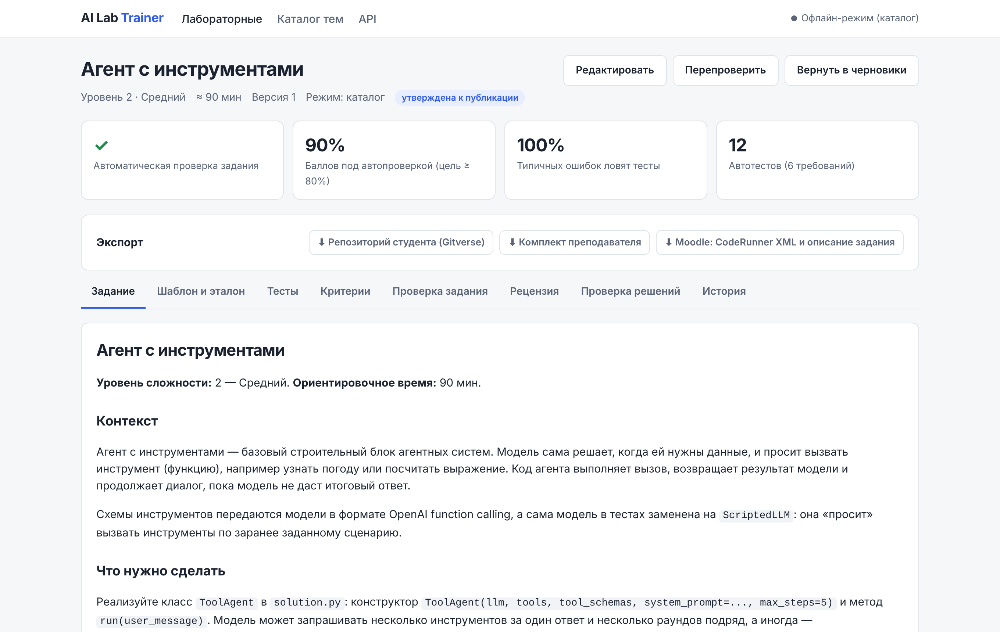
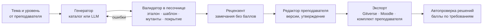

# AI Lab Trainer — ИИ-агент для создания лабораторных работ по агентной разработке

Преподаватель пишет тему занятия («Создание агента с инструментами») и выбирает уровень сложности.
Агент готовит лабораторную работу целиком: условие, шаблон решения, эталон, автотесты и критерии
оценивания. Затем он сам проверяет её в песочнице и даёт преподавателю отредактировать и утвердить.
После этого работу можно экспортировать в Gitverse и Moodle и автоматически проверять решения студентов.

Это MVP проекта: всё работает локально, без внешних сервисов. LLM подключается по желанию.

## Соответствие критериям проекта

| Критерий | Как выполнен в MVP |
| --- | --- |
| Не менее 5 лабораторных работ | Каталог: 5 тем × 3 уровня = 15 проверенных работ (`labgen build-catalog`). С подключённой LLM — генерация по любой теме |
| Минимум 3 уровня сложности | Базовый, средний, продвинутый. Уровень задаётся проверяемыми признаками, а не меткой от LLM (`labgen/levels.py`) |
| Задания создаются автоматически из темы | Тема → подбор по каталогу (офлайн) или генерация LLM с циклом «проверка → исправление» |
| Автопроверка ≥ 80% проверяемых требований | Во всех 15 работах автотестами проверяется 90% баллов; валидатор не пропускает работу с покрытием ниже 80% |
| Интеграция или корректный импорт в Moodle или Gitverse | Moodle — вопрос CodeRunner в Moodle XML с автопроверкой. Gitverse — репозиторий студента с CI. Плюс JSON API для интеграций |
| Преподаватель может отредактировать задание перед публикацией | Веб-редактор всех частей работы, версии с откатом, утверждение только после успешной проверки |

## Быстрый старт

```bash
python -m venv .venv && source .venv/bin/activate   # Windows: .venv\Scripts\activate
pip install -e .

labgen build-catalog --approve      # создать, проверить и экспортировать 15 работ каталога (~30 с)
labgen serve                        # веб-интерфейс: http://127.0.0.1:8000
```

Без установки пакета все команды доступны как `python -m labgen ...`.

Скриншоты интерфейса — в `docs/screenshots/`: список работ, карточка работы, отчёт проверки
задания, редактор и результат автопроверки решения.



## Подключение LLM

Скопируйте `.env.example` в `.env` и укажите OpenAI-совместимый API: OpenAI, локальную модель
через Ollama или vLLM либо облачную модель с совместимой точкой доступа.

```bash
LABGEN_LLM_BASE_URL=http://localhost:11434/v1
LABGEN_LLM_MODEL=qwen2.5-coder:14b
```

С LLM появляются:
- генерация работ по произвольной теме, в том числе на основе материалов преподавателя;
- рецензия задания (замечания без баллов);
- симулированные студенты;
- пояснения ошибок в отчёте автопроверки. Баллы при этом по-прежнему ставят только тесты.

Если LLM не настроена, сервис работает на каталоге.

## Как это работает



1. **Генератор** создаёт спецификацию работы: условие, шаблон `solution.py`, эталон, публичные и
   скрытые тесты, требования с баллами и «мутанты» — типичные ошибки студентов. В LLM-режиме
   генератор получает образец из каталога того же уровня. Если проверка не пройдена, он получает
   замечания валидатора и исправляет работу (до `LABGEN_MAX_ATTEMPTS` попыток).
2. **Валидатор** запускает в изолированном процессе:
   - эталон: должен пройти все тесты, и повторный прогон должен дать тот же результат;
   - шаблон: не должен решать задачу;
   - мутанты: каждый должен быть пойман тестами.

   Ещё он считает долю баллов под автопроверкой и проверяет, что каждый тест привязан к требованию.
3. **Рецензент** готовит замечания для преподавателя: формальные правила, а с LLM — содержательная
   рецензия. Баллов он не ставит.
4. **Преподаватель** правит работу в веб-редакторе. Каждое сохранение — новая версия с повторной
   проверкой. Утвердить можно только работу без ошибок проверки.
5. **Автопроверка** запускает решение студента на публичных и скрытых тестах и начисляет баллы
   по требованиям. Есть частичный балл, понятные комментарии и пакетная проверка папки с выгрузкой в CSV.

### Как тестируется код агентов

Студенты пишут агентов, которые обращаются к LLM. Поэтому поведение их кода каждый раз разное,
и обычными тестами «вход → выход» его не проверить. В MVP модель в тестах заменена на `ScriptedLLM`
из `agentkit.py`. Это «LLM по сценарию»: она отдаёт заранее заданные ответы, включая вызовы
инструментов и сбои API, и записывает все запросы агента. Тесты проверяют поведение:
- какие сообщения агент отправил модели;
- какие инструменты он вызвал и с какими аргументами;
- сколько раз он обратился к модели и когда остановился.

Такие тесты детерминированы, не требуют сети и денег на API и проверяются мутационным анализом.
В обзоре литературы этот вопрос отмечен как открытый, поэтому подход можно заявить как R&D-вклад проекта.

### Уровни сложности

| Уровень | Признаки | Требований с автопроверкой |
| --- | --- | --- |
| 1 · Базовый | один сценарий, корректные данные, подробный шаблон с TODO | 3 |
| 2 · Средний | несколько шагов или инструментов, ограничения, ожидаемые ошибки | 6 |
| 3 · Продвинутый | сбои LLM и инструментов, повторы, трассировка, композиция агентов | 8 |

Уровень задаётся объективными признаками, потому что LLM плохо оценивает и регулирует сложность.
Метки сложности от модели почти не совпадают с реальной сложностью (An & Wang, 2026), а упрощать
задания модели получается хуже, чем усложнять (Bloom-aligned framework, 2026).

### Темы каталога

| Тема | Чему учит |
| --- | --- |
| Структурированный вывод LLM | промпт-инструкция, разбор JSON, валидация, повторные запросы с обратной связью |
| Агент с инструментами | function calling, цикл «модель → инструменты», лимит шагов, ошибки инструментов, трасса |
| Агент с памятью диалога | история, скользящее окно, атомарность, сжатие истории через LLM |
| RAG: ответы по базе знаний | поиск, сборка контекста, ссылки на источники, отказ без контекста, переформулировка |
| Мультиагентная система | диспетчер на LLM, запасной маршрут, изоляция сбоев, цикл «автор — критик» |

## Экспорт

| Формат | Что внутри | Как использовать |
| --- | --- | --- |
| Репозиторий студента | `README.md` (условие), `solution.py` (шаблон), `agentkit.py`, `tests/test_public.py`, CI `.gitverse/workflows/tests.yaml` | Создать репозиторий-шаблон в Gitverse; CI запускает публичные тесты при push |
| Комплект преподавателя | `lab.json`, эталон, скрытые тесты, `RUBRIC.md`, `VALIDATION.md` | `labgen grade lab.json submissions/ --csv grades.csv` |
| Moodle | `moodle_coderunner.xml`, `assignment.html` | Банк вопросов → Импорт → Moodle XML (нужны плагин CodeRunner и сервер Jobe) или элемент «Задание» |

Что нужно проверить на стороне вуза перед курсом:
- **CodeRunner.** Импортируйте XML на тестовом Moodle и сохраните вопрос. CodeRunner прогонит на
  вашем сервере Jobe эталонное решение по всем тестам. Логика шаблона вопроса проверена эмуляцией
  в `tests/test_exporters.py`.
- **CI Gitverse.** Файл использует синтаксис GitHub Actions (`on`/`jobs`/`runs-on`/`steps`), как
  в примерах GitVerse CI/CD. Запустите его на тестовом репозитории и уточните доступные раннеры
  и действие `actions/checkout`.

## Командная строка

```bash
labgen catalog                                   # темы и уровни
labgen generate "Агент с инструментами" -l 2      # создать работу (auto: LLM, если настроена)
labgen generate "Агент для расписания" -l 3 --mode llm --materials lecture.md --simulate 3
labgen list                                      # все работы
labgen show <id> | validate <id> | approve <id>
labgen export <id> --kind all --out export/      # student / teacher / moodle / all
labgen grade <id> solution.py                    # отчёт по требованиям
labgen grade lab.json submissions/ --csv grades.csv
labgen serve --port 8000
```

## JSON API

Документация Swagger доступна по адресу `/docs`. Основные методы:
- `GET /api/labs` — список работ;
- `GET /api/labs/{id}` — работа целиком;
- `POST /api/labs` — создать работу: `{"topic", "level", "mode"}`;
- `POST /api/labs/{id}/grade` — проверить решение: `{"code", "student"}`. Метод подходит для вызова
  из CI репозитория или плагина LMS.

## Структура проекта

```
labgen/
  catalog/            темы каталога: метаданные + sources/<тема>/{reference,starter_N,tests}.py
  pipeline/           generator · validator · reviewer · students · orchestrator · prompts
  llm/                OpenAI-совместимый клиент, тестовая модель-«пустышка»
  exporters/          gitverse · moodle (CodeRunner) · teacher
  runtime/agentkit.py среда студента: ScriptedLLM, формат сообщений, клиент LLM
  sandbox.py          изолированный запуск pytest (лимиты, тайм-ауты, запрет сети)
  grader.py           баллы по требованиям, отчёты, CSV
  storage.py          хранилище работ с версиями и результатами проверки
  service.py          общий слой для веб-интерфейса и CLI
  web/                FastAPI + шаблоны интерфейса преподавателя
tests/                тесты проекта (80 тестов, в том числе прогон всех 15 работ каталога)
```

```bash
pytest              # все тесты (~1 мин)
pytest -m "not slow" # без полного прогона каталога
```

## Исследования

- [Open-source LLM vs API](research/OPEN-SOURCE-LLM-VS-API-RESEARCH.md) — выбор модели для генерации.

## Ограничения MVP и следующие шаги

- **Изоляция.** Сейчас это отдельный процесс с лимитами CPU, памяти и времени и запретом сокетов.
  Для эксплуатации нужен контейнер без сети (Docker или gVisor). Интерфейс `run_tests` для этого
  менять не придётся.
- **Публикация через API.** Сейчас экспорт файлов и импорт. Следующий шаг — Moodle Web Services
  и Gitverse API, чтобы создавать курс или репозиторий автоматически.
- **Материалы преподавателя.** Сейчас передаются в контекст LLM целиком (до 12 тыс. символов).
  Для больших методичек нужен RAG.
- **Калибровка сложности.** Нужно сопоставить уровни со статистикой реальных студентов.
- **Доступ.** Нет авторизации и ролей; сервис рассчитан на запуск внутри сети вуза.
- **Проверка с настоящей LLM.** LLM-режим проверен тестовой моделью-«пустышкой», в том числе цикл
  исправления. Качество генерации на конкретной модели нужно оценить на тестовых темах.
